<p align="center">
  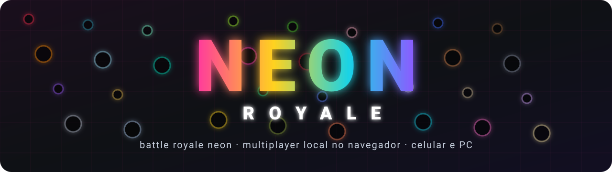
</p>

<p align="center">
  
  
  
  
  
</p>

<h3 align="center">Silhuetas pretas. Cores neon. Um sobrevivente.</h3>

<p align="center">
  Battle royale 2D minimalista para jogar com os amigos pelo navegador — no celular ou no PC, sem instalar nada.<br/>
  <b>30 personagens · 25 mapas · 9 modos de jogo · 2 a 6 jogadores</b>
</p>

---

<table>
  <tr>
    <td width="50%">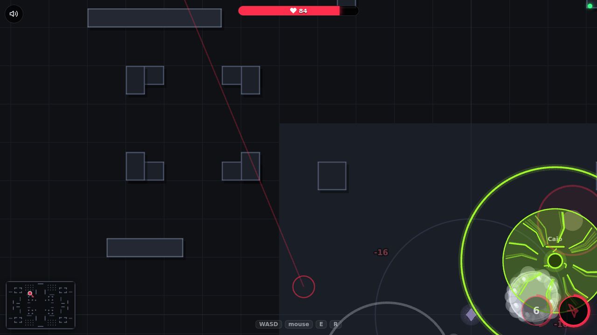<p align="center"><sub>Royale na <b>Praça</b>: onda de choque do Lucas no meio da briga</sub></p></td>
    <td width="50%">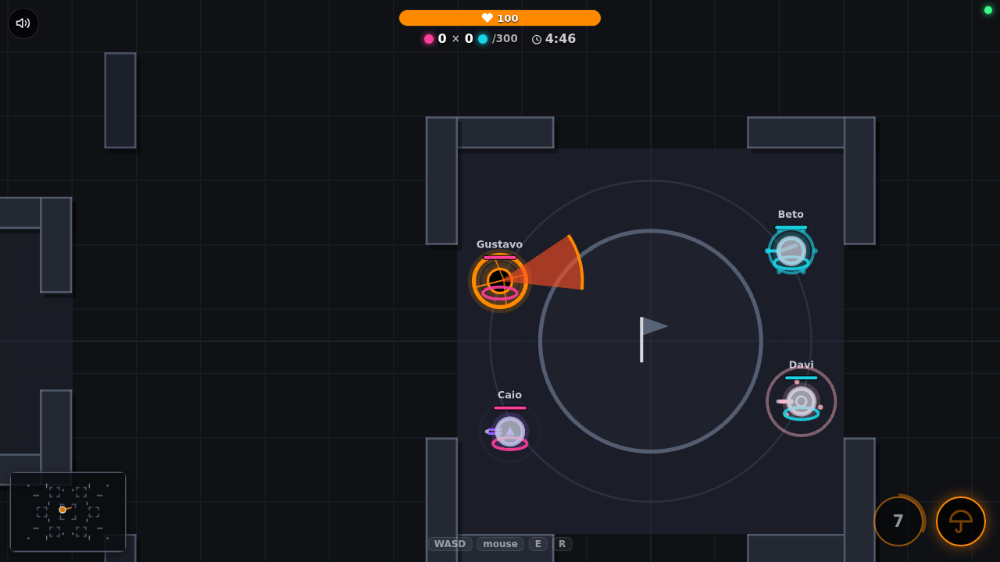<p align="center"><sub><b>Pega Bandeira em equipe</b> na Colmeia, com o escudo do Daniel</sub></p></td>
  </tr>
  <tr>
    <td width="50%">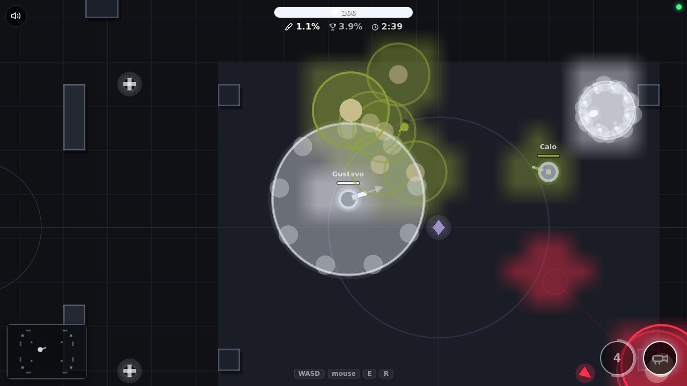<p align="center"><sub><b>Pintão</b> no Coliseu: tinta, explosões e granadas pintando o chão</sub></p></td>
    <td width="50%">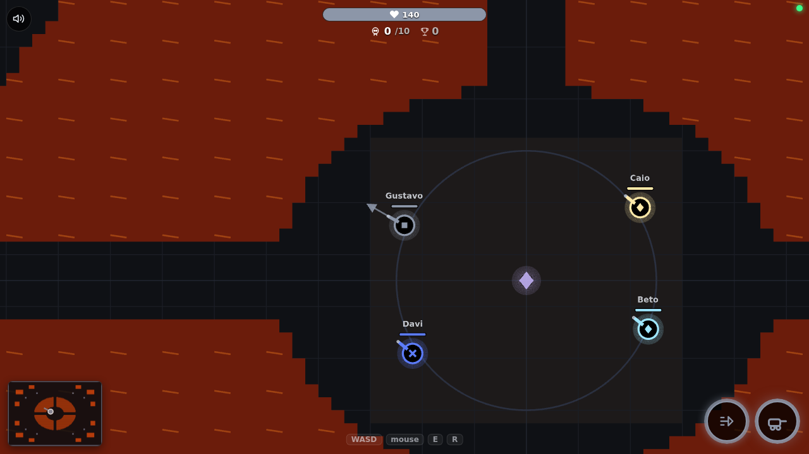<p align="center"><sub>A ilha da <b>Cratera</b>, cercada por um lago de lava com 4 pontes</sub></p></td>
  </tr>
</table>

## Destaques

- **Jogue em qualquer tela.** Abra o endereço (ou leia o QR code) no celular ou no PC. Joystick e botões no toque, WASD e mouse no teclado.
- **Nada de mira automática.** Cada tiro sai para onde você aponta. No celular, arraste o botão de ataque para mirar.
- **30 personagens com papéis de verdade:** explosivos, assassinos invisíveis, tanques, curandeiros, controle de área, armadilhas, portais de fuga, clones, drones…
- **25 mapas** (todos simétricos, menos um assimétrico de propósito), com lava, gelo, lama, abismos, moitas, esteiras, portais, trampolins, paredes que se movem, muros que quebram e até um mapa no escuro.
- **9 modos:** do royale clássico ao Pintão, passando por Pega Bandeira e Corrida Armada.
- **Servidor autoritativo** com previsão de movimento no aparelho: nada de "teleporte" ao andar, e nada de trapaça pelo código (invisíveis e minas nem chegam ao aparelho de quem não deve ver).
- **Visual 100% vetorial e sons gerados no navegador:** o jogo inteiro não tem um arquivo de imagem nem de áudio.

## Como jogar

> Precisa de um computador com **Node.js 22 LTS** (ou 20+). Os outros jogadores só precisam de um navegador.

```bash
npm install
npm run build
npm start
```

O terminal mostra o endereço da rede local (algo como `http://192.168.0.12:3100`) e um **QR code**.

1. Abra o endereço e toque em **Criar sala**.
2. Os amigos leem o QR code ou entram com o **código de 6 letras**.
3. O anfitrião escolhe **modo → mapa**, todo mundo escolhe o **personagem**, e o anfitrião aperta **▶**.

<p align="center">
  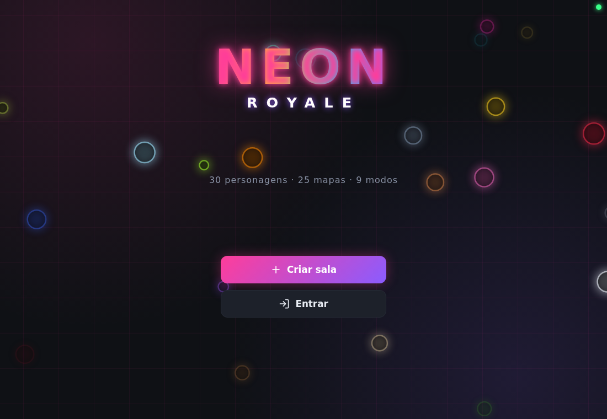
  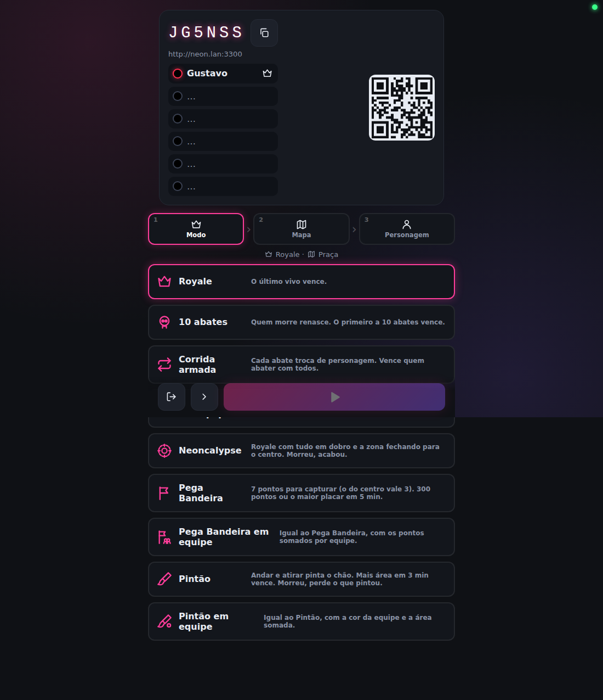
</p>

### Jogando pela internet

O jogo foi feito para a mesma rede Wi-Fi, mas dá para abrir para amigos de longe com um **túnel da Cloudflare** (ninguém precisa instalar nada além de você):

```bash
# terminal 1
npm start

# terminal 2
brew install cloudflared            # só na primeira vez
cloudflared tunnel --url http://localhost:3100
```

Mande para os amigos o endereço `https://…trycloudflare.com` que aparecer.

## Controles

| | Computador | Celular |
|---|---|---|
| **Mover** | WASD ou setas | joystick na metade esquerda da tela |
| **Mirar e atacar** | mouse + clique (segurar atira sem parar) ou espaço | botão grande: tocar ataca, segurar ataca sem parar, arrastar mira |
| **Habilidade ativa** | E ou Q | botão menor |
| **Supernova** | R | botão colorido (aparece quando você tem uma) |
| **Espectador** (após morrer) | clique ou espaço troca de jogador; WASD solta a câmera | botão de ataque troca; joystick solta a câmera |

<p align="center">
  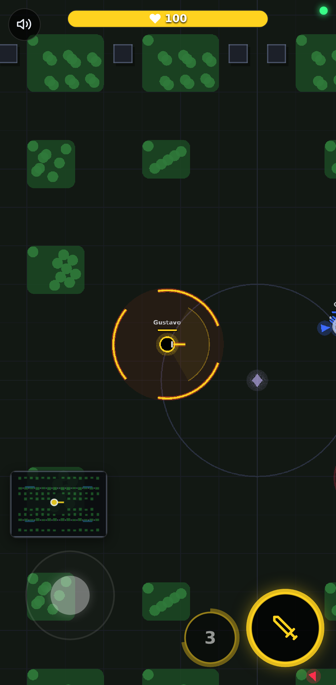<br/>
  <sub>No celular: joystick, mira por arraste, mini mapa acima do joystick e as moitas da <b>Selva</b></sub>
</p>

## Modos de jogo

| Modo | Como funciona |
|---|---|
| **Royale** | O último vivo vence. Morreu, vira espectador. |
| **10 abates** | Quem morre renasce em 2 s. O primeiro a 10 abates vence. |
| **Corrida armada** | Cada abate troca você para o próximo personagem. Vence quem abater com todos os 30. |
| **Mata-mata em equipe** | 2 equipes, sem fogo amigo. A primeira a 25 abates vence. Ao morrer, troque de personagem. |
| **Neoncalypse** | Royale com dano e habilidades em dobro, +50% de velocidade e uma zona que fecha para o centro. |
| **Pega Bandeira** | 7 pontos para capturar (fique 3 s sozinho em cima). Cada um rende 1/s; o do centro, 3/s. 300 pontos ou o maior placar em 5 min. |
| **Pega Bandeira em equipe** | O mesmo, com os pontos somados por equipe. |
| **Pintão** | Andar e atirar pinta o chão. Mais área em 3 min vence — e quem morre perde o que pintou. |
| **Pintão em equipe** | O mesmo, com a cor da equipe. Quem morre apaga só o que ele mesmo pintou. |

Nos modos em equipe, o **líder** (o primeiro de cada time) escolhe a cor da equipe, e os times trocam de lado a cada partida.

## Personagens

<p align="center">
  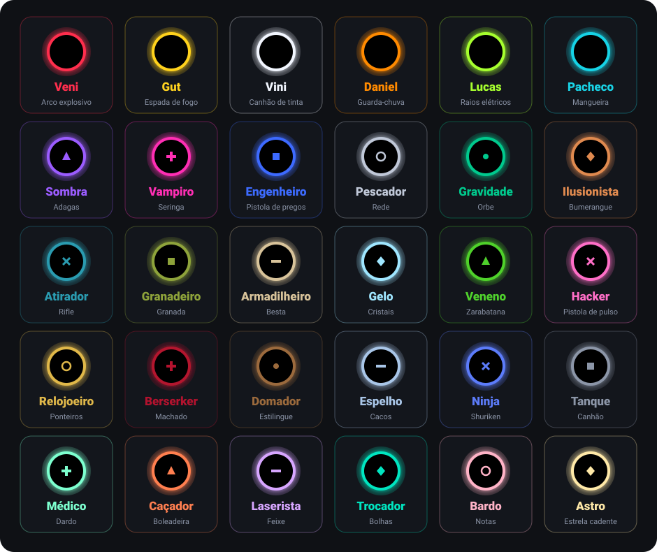
</p>

Todos têm **100 de vida** e **190 px/s**, salvo quando a passiva diz o contrário. Cada um tem uma **arma**, uma **habilidade ativa** (com recarga) e uma **passiva** (sempre ligada). Um símbolo dentro da silhueta ajuda a diferenciar cores parecidas.

<details>
<summary><b>Ver todos os 30 em detalhes</b></summary>

| Personagem | Arma (recarga) | Ativa (recarga) | Passiva |
|---|---|---|---|
|  **Veni** | Arco explosivo (1,5 s) | Teletransporte (10 s): Salta para o ponto mais longe dos inimigos mais próximos (atravessa obstáculos). | **Flecha preparada:** A primeira flecha depois de teletransportar causa +50% de dano e explode maior. |
|  **Gut** | Espada de fogo (0,75 s) | Giro flamejante (8 s): Golpe em 360° que empurra e deixa queimando por 3 s. | **Velocidade alta:** Anda 40% mais rápido. |
|  **Vini** | Canhão de tinta (0,9 s) | Balde (7 s): Espalha uma poça grande em volta e empurra quem estiver perto. | **Surfista de tinta:** Anda 30% mais rápido sobre a própria tinta. A tinta revela invisíveis. |
|  **Daniel** | Guarda-chuva (0,6 s) | Escudo (10 s): Abre o guarda-chuva em volta de si: bloqueia dano e projéteis de todos os lados por 5 s. | **Chuva de agulhas:** Quando o escudo acaba, solta 12 projéteis em todas as direções (3 de dano cada). |
|  **Lucas** | Raios elétricos (0,6 s) | Onda de choque (10 s): Um anel elétrico que se expande longe, causa dano e empurra. | **Estática:** Quem acerta o Lucas (com qualquer ataque) leva 2 de dano de volta. |
|  **Pacheco** | Mangueira (18 gotas/s) | Voo (7 s): Voa por 4 s por cima de obstáculos e água (a borda do mapa segura). | **Nadador:** Anda sobre a água, mas a lava queima o dobro. |
|  **Sombra** | Adagas (0,5 s) | Invisível (10 s): Some por 5 s. Atacar revela; o primeiro acerto causa +50%. Tinta, dano e faro revelam. | **Pelas costas:** +30% de dano em quem está de costas para ela. |
|  **Vampiro** | Seringa (0,9 s) | Totem de sangue (7 s): Área que cura 5 por segundo só para ele, por 5 s. | **Sede:** Recupera 10 de vida ao eliminar alguém. |
|  **Engenheiro** | Pistola de pregos (0,9 s) | Parede (6 s): Ergue à frente uma parede sólida por 5 s, que bloqueia tudo. | **Blindado:** Leva 20% menos dano de projéteis. |
|  **Pescador** | Rede (0,8 s) | Gancho (2 s): Lança um gancho que puxa o inimigo atingido até ele. | **Ímã:** Pega pickups a até 150 px de distância. |
|  **Gravidade** | Orbe (1,2 s) | Buraco negro (8 s): Por 2 s, puxa todos os inimigos para um ponto à frente. | **Massa:** Imune a empurrões e puxões. |
|  **Ilusionista** | Bumerangue (1,1 s) | Clones (6 s): 5 cópias saem em direções diferentes por 4 s e enganam os outros. | **Fuga:** Uma vez por partida, ao cair abaixo de 25 de vida, fica invisível por 1,5 s. |
|  **Atirador** | Rifle (1 s) | Corrida (8 s): Anda 50% mais rápido por 3 s. | **Paciência:** Parado por 1 s, o próximo tiro causa +25%. Leva 25% mais dano de golpes corpo a corpo. |
|  **Granadeiro** | Granada (1,6 s) | Chuva de granadas (8 s): 5 granadas espalhadas numa área à frente. | **Explosão final:** Ao ser eliminado, explode e causa 20 de dano em volta. |
|  **Armadilheiro** | Besta (0,85 s) | Mina (6 s): Mina quase invisível: prende quem pisar por 1,5 s e causa 10. Até 3 minas. | **Faro:** Vê minas e invisíveis a até 150 px. |
|  **Gelo** | Cristais (0,6 s) | Congelar (8 s): Congela por 1,5 s todos em volta e causa 8. | **Pele fria:** Quem o acerta corpo a corpo ganha 2 camadas de frio. |
|  **Veneno** | Zarabatana (0,7 s) | Nuvem tóxica (8 s): Nuvem à frente que causa 5 por segundo a quem estiver dentro, por 6 s. | **Antídoto:** Imune a veneno e queimadura. |
|  **Hacker** | Pistola de pulso (0,55 s) | Pane (3 s): Disparo que deixa o atingido sem habilidade ativa por 4 s e causa 5. | **Glitch:** Não aparece nas setas dos inimigos. |
|  **Relojoeiro** | Ponteiros (0,8 s) | Voltar no tempo (9 s): Volta para onde estava 5 s atrás (e recupera a vida, se era maior). | **Eco:** Ao voltar no tempo, solta uma pequena onda de choque que causa 5. |
|  **Berserker** | Machado (1 s) | Fúria (13 s): Por 4 s, ataca 40% mais rápido e recupera 30% do dano causado. | **Sangue quente:** Quanto menos vida, mais dano (até +50%). |
|  **Domador** | Estilingue (0,8 s) | Drone (14 s): Um drone segue o Domador por 8 s e atira no inimigo mais próximo. | **Companheiro:** Cada eliminação tira 5 s da recarga do drone. |
|  **Espelho** | Cacos (0,8 s) | Reflexo (8 s): Por 3 s, devolve os projéteis para quem atirou. | **Duplicata:** Ao levar dano, 35% de chance de deixar um reflexo que confunde. |
|  **Ninja** | Shuriken (0,55 s) | Avanço (7 s): Avança 200 px, atravessando inimigos e cortando quem estiver no caminho. | **Leveza:** Anda 15% mais rápido. As shurikens quicam 2 vezes nas paredes. |
|  **Tanque** | Canhão (1,4 s) | Investida (11 s): Avança 160 px, empurrando e causando 12 em quem estiver no caminho. | **Couraça:** 140 de vida, mas anda 15% mais devagar. |
|  **Médico** | Dardo (0,7 s) | Kit (14 s): Cura 30 e remove efeitos ruins (veneno, queimadura, frio, prisão, lentidão, pane, marca). | **Regeneração:** Recupera 2 de vida por segundo depois de 3 s sem levar dano. |
|  **Caçador** | Boleadeira (1 s) | Marcar (12 s): Tiro que marca o alvo por 5 s: ele leva +25% de dano de todos e não fica invisível; as boleadeiras do Caçador viram teleguiadas até ele, com metade do dano. | **Rastreador:** +20% de dano em alvos lentos ou presos. |
|  **Laserista** | Feixe (0,45 s) | Sobrecarga (10 s): Por 3 s, o feixe recarrega na metade do tempo. | **Foco:** Acertos seguidos no mesmo alvo causam +1 cada (até +4). |
|  **Trocador** | Bolhas (0,8 s) | Troca (5 s): Troca de lugar com o inimigo mais próximo (até 700 px). | **Desorientar:** Depois da troca, o inimigo fica 30% mais lento por 1,5 s. |
|  **Bardo** | Notas (0,65 s) | Canção (7 s): Por 4 s, anda e ataca 35% mais rápido. | **Refrão:** A cada 4 acertos, a nota causa o dobro. |
|  **Astro** | Estrela cadente (1,3 s) | Meteoro (12 s): Depois de 1 s de aviso, um meteoro cai à frente: 30 no centro, 12 na borda. | **Constelação:** Cada eliminação recarrega o meteoro na hora. |

Os números ficam em [`shared/src/personagens.ts`](shared/src/personagens.ts) — ajuste à vontade.

</details>

## Mapas

<p align="center">
  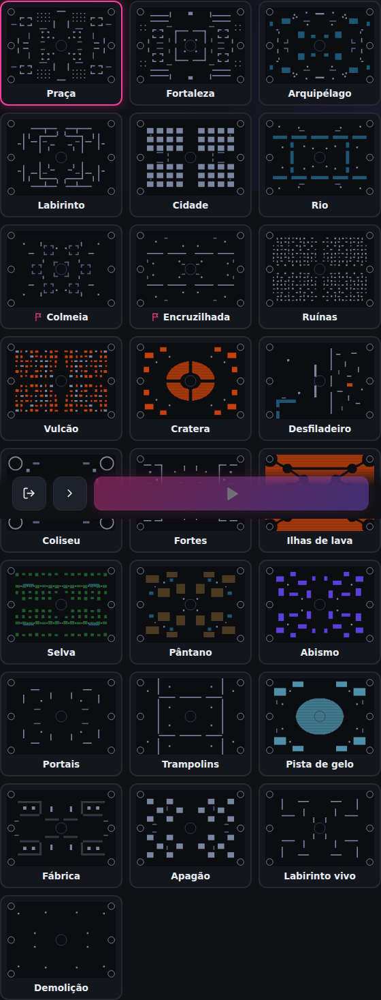
</p>

<details>
<summary><b>Ver todos os 25 mapas</b></summary>

| Mapa | Como é |
|---|---|
| **Praça** | Praça central com pilares, galpões com portas, bosque de pilares e muretas. |
| **Fortaleza** | Muralha no centro com quatro portões, corredores longos e quartéis. |
| **Arquipélago** | Lagos que bloqueiam a passagem mas não os tiros, rochas e ilhas. |
| **Labirinto** | Anéis de muros em volta do centro, com passagens estreitas e becos. |
| **Cidade** | Quarteirões em grade com ruas retas, cercas baixas e uma praça no centro. |
| **Rio** | Rios cruzando o mapa com pontes estreitas; campos abertos com poucas pedras. |
| **Colmeia** | Feito para o Pega Bandeira: 7 praças muradas, cada uma com um ponto, ligadas por corredores. *(Pega Bandeira)* |
| **Encruzilhada** | Feito para o Pega Bandeira: 3 caminhos largos com 2 pontos cada e o maior no cruzamento do centro. *(Pega Bandeira)* |
| **Ruínas** | Muitos obstáculos: pilares e muros quebrados por todo lado. Linhas de tiro curtas e emboscadas. |
| **Vulcão** | Dezenas de poças de lava (8 de dano por segundo) entre pedras. Cuidado com empurrões. |
| **Cratera** | Lago de lava gigante em volta da ilha do centro, com 4 pontes, e poças grandes nas bordas. |
| **Desfiladeiro** | Assimétrico: campo aberto à esquerda, cânion estreito e cheio de cobertura à direita, rio com uma ponte embaixo. |
| **Coliseu** | Arena pequena e quase vazia. Partidas rápidas e diretas, ótima para 1×1 e 2×2. |
| **Fortes** | Duas bases muradas, uma de cada lado, com portões e torres. Pensado para equipes. |
| **Ilhas de lava** | Quase tudo é lava, com ilhas ligadas por pontes estreitas. Empurrões viram a principal arma. |
| **Selva** | Moitas por todo lado: quem está dentro de uma fica invisível para quem está longe. Atacar revela. |
| **Pântano** | Grandes áreas de lama (40% mais lento), lagoas e árvores mortas. |
| **Abismo** | Buracos sem fundo: cair é morte na hora, e o abate vai para quem empurrou. |
| **Portais** | Pares de portais ligam lados opostos do mapa: atalhos para atacar e fugir. |
| **Trampolins** | Câmaras separadas por muros; trampolins lançam por cima deles até o outro lado. |
| **Pista de gelo** | Pistas de gelo por todo o mapa: o personagem escorrega e demora para frear. |
| **Fábrica** | Esteiras arrastam quem está em cima; prensas fecham de tempos em tempos. |
| **Apagão** | Mapa escuro: cada um só vê em volta de si e perto dos postes de luz. |
| **Labirinto vivo** | Paredes que abrem e fecham a cada 10 s, trocando os caminhos durante a partida. |
| **Demolição** | Muros que quebram com tiros e explosões: o mapa vai se abrindo durante a partida. |

</details>

### O que tem pelo mapa

| | |
|---|---|
| **Área segura** | Cada jogador nasce numa área na sua cor: lá dentro não leva dano por até 8 s seguidos. Atacar de dentro desliga a proteção. |
| **Cruz** | +35 de vida (volta em 20 s). |
| **Losango** | +50% de dano por 8 s (volta em 30 s). |
| **Supernova** | A cada 30 s aparece uma num lugar sorteado, com uma seta branca na borda da tela. Quem pega ganha um botão extra: 5 s com dano em dobro, recargas pela metade e +50% de velocidade. |
| **Lava** | Queima 8 por segundo. Quem morre nela dá o abate para quem o acertou por último. |
| **Abismo** | Cair é morte na hora — empurrões viram armas. |
| **Lama · Gelo · Esteiras** | Deixa lento · escorrega · arrasta. |
| **Moitas · Escuridão** | Escondem quem está dentro (ou longe da luz). |
| **Portais · Trampolins** | Levam para o outro lado do mapa · lançam por cima dos muros. |
| **Prensas · Muros** | Paredes que abrem e fecham · muros que quebram com tiros e explosões. |

E ainda: **mini mapa** no canto, **sons** gerados na hora (com botão de mudo) e o anfitrião pode **expulsar** jogadores do lobby.

## Por dentro

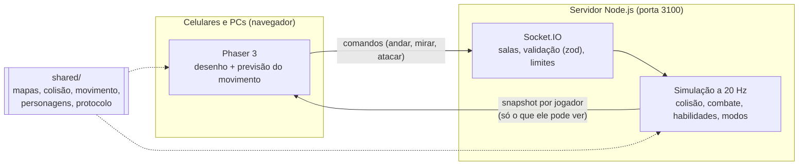

- **Servidor autoritativo:** o aparelho só manda intenções; quem decide dano, colisão e vitória é o servidor.
- **Previsão com reconciliação:** o seu personagem anda na hora no aparelho; quando chega a posição oficial, os comandos ainda pendentes são reaplicados — inclusive no gelo, na lama e nas esteiras, que usam o mesmo código dos dois lados.
- **Os outros jogadores** são desenhados ~110 ms no passado, interpolando entre atualizações.
- **Visibilidade no servidor:** cada jogador recebe só o que pode ver (invisíveis, moitas, escuridão e minas).

<details>
<summary><b>Estrutura de pastas</b></summary>

```
shared/src/     regras usadas no servidor e no navegador
  personagens.ts   os 30 personagens e os números das habilidades
  mapa.ts          os 25 mapas (gerados em código, simétricos)
  colisao.ts       colisão círculo × blocos, linha de tiro
  movimento.ts     movimento com terreno (lama, gelo, esteiras)
  protocolo.ts     mensagens entre aparelho e servidor
server/src/
  jogo.ts          a simulação: combate, habilidades, modos, mapas
  salas.ts         salas, lobby, equipes, expulsão
  index.ts         HTTP + Socket.IO + laço a 20 Hz
client/src/
  scenes/Arena.ts  a partida em Phaser (desenho, previsão, efeitos)
  ui/app.ts        menus, lobby em etapas e HUD
  audio/som.ts     sons sintetizados (Web Audio)
tests/           165 testes (Vitest)
```

</details>

## Desenvolvimento

```bash
npm run dev      # servidor + Vite com recarga automática (abra pela porta 5173)
npm test         # 165 testes: regras, personagens, mapas, modos e salas
npm run build    # checagem de tipos + build do cliente e do servidor
```

Os testes conferem, por exemplo, que **todo mapa** é simétrico, tem o centro aberto e deixa ir de qualquer nascimento a qualquer pickup **sem pisar em lava nem abismo** — e que cada habilidade faz exatamente o que a tabela promete.

**Feito com** TypeScript, Phaser 3, Vite, Socket.IO, Express, Zod e Vitest.

---

<p align="center"><sub>Neon Royale — feito para jogar com os amigos no mesmo sofá (ou no mesmo Wi-Fi).</sub></p>
